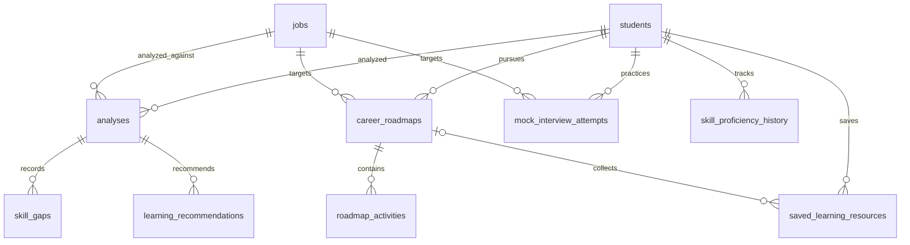

# SRM Placement Intelligence

A React/Vite frontend and Flask API for student/job records, normalized skill matching, personalized learning, scored practice interviews, proficiency history, model diagnostics, and PDF/CSV reports. Managed records and learning history use SQLite; dataset summaries and skill vocabulary come from the supplied data/index.

## Project map

- `backend/`: Flask routes, SQLite helpers, dataset support, matching, recommendations, model registry, reports.
- `frontend/`: React pages, Vite scripts, Axios API client, UI styles.
- `model/`: five classifier artifacts, training medians, scaler, and feature configuration.
- `data/`: local-only source CSV, derived dataset index, and SQLite database. Student-level data files are excluded from Git.
- `notebooks/`: `final colab.ipynb`, Python export, and validation notes.
- `AUDIT_REPORT.md`: full feature inventory, execution evidence, and demo instructions.

## Environment setup

The project-local `.venv` was verified on Python 3.13.5. Install its pinned dependencies from the project root:

```powershell
.\.venv\Scripts\Activate.ps1
python -m pip install -r backend/requirements.txt
```

The Python dependency lock pins the installed stack, including scikit-learn 1.6.1 to match the model bundle. The `.venv` in the parent checkout folder is stale; use the project-local `.venv`.

Python 3.11/3.12 were not installed on the audit machine. scikit-learn 1.6 supports Python 3.13, and the complete model was verified there. If you specifically require Python 3.12, install it and make a separate environment:

```powershell
winget install --exact --id Python.Python.3.12
py -3.12 -m venv .venv312
.\.venv312\Scripts\Activate.ps1
python -m pip install -r backend/requirements.txt
```

## Run locally

From the project root, start Flask in one terminal. The backend resolves its default SQLite file relative to the project, not the current directory. Clear any inherited override to make the intended default explicit:

```powershell
Remove-Item Env:PLACEMENT_DB_PATH -ErrorAction SilentlyContinue
& '.\.venv\Scripts\python.exe' -m backend.app
```

In another terminal:

```powershell
Set-Location .\frontend
# Run once if node_modules is absent:
npm install
npm run dev
```

Open `http://127.0.0.1:5173/`. Flask runs at `http://127.0.0.1:5000`. The database initializes at backend startup. Override `VITE_API_URL` in `frontend/.env` for a different API host; `PLACEMENT_DB_PATH` and comma-separated `PLACEMENT_CORS_ORIGINS` configure the database location and allowed origins.

To stop an old Flask debug/reloader instance bound to port 5000, first use `Ctrl+C` in its terminal. If that terminal is unavailable, this PowerShell command finds the listener and only stops it and its ancestors whose command line identifies the backend module:

```powershell
$processes = Get-CimInstance Win32_Process
$listenerIds = Get-NetTCPConnection -LocalPort 5000 -State Listen -ErrorAction SilentlyContinue |
  Select-Object -ExpandProperty OwningProcess -Unique
$stopIds = @()
foreach ($listenerId in $listenerIds) {
  $currentId = $listenerId
  while ($currentId) {
    $process = $processes | Where-Object { $_.ProcessId -eq $currentId } | Select-Object -First 1
    if (-not $process) { break }
    if ($process.CommandLine -match 'backend\.app') { $stopIds += $process.ProcessId }
    $currentId = $process.ParentProcessId
  }
}
$stopIds | Sort-Object -Unique | ForEach-Object { Stop-Process -Id $_ -Force }
```

The backend logs the selected database path and whether it is the project default or an explicit override. Confirm it at `GET /api/health`. For this checkout, the default is `data/placement_intelligence.sqlite3`; the live backend was restarted with `PLACEMENT_DB_PATH` cleared, and health now reports this project-default path. The earlier browser-test backend had an explicit temporary override, which health exposed; that process was stopped, and its temporary database was left intact. The default database passed `PRAGMA integrity_check` before and after restart. Its existing 1 student, 1 job, 5 analyses, and 1 interview attempt remained; the resource request seeded 32 catalog entries. Existing records were preserved when the earlier temporary database was copied into the project database.

The raw student/job CSV, derived profile index, and SQLite database are intentionally gitignored because they contain student identifiers or student-level academic/skills information. Do not publish these data files. When setting up a clone, place an authorized copy of `data/student_job_pairs_rebuilt.csv` locally and run `python -m backend.build_dataset_index` to generate the required local index. The SQLite database is initialized locally on backend startup.

To create a production frontend build, run `npm run build`. The Vite scripts use the runner config loader for config compatibility. The latest verified build produced a 290.38 kB entry bundle (92.52 kB gzip) and a separately loaded 436.70 kB chart chunk (117.54 kB gzip); the prior entry bundle was 725.67 kB.

Run the isolated backend integration suite from the project root with `.\.venv\Scripts\python.exe -m unittest discover -s backend\tests -v`. Tests use a temporary SQLite database and cover all five available classifiers, skill aliases and matching, resource recommendations, persisted mock interviews and proficiency history, student isolation, restart persistence, and PDF/CSV exports. `.\.venv\Scripts\python.exe -m compileall -q backend` compiles the backend.

If the source CSV changes, rebuild its compact index from the project root:

```powershell
python -m backend.build_dataset_index
```

## API

`GET /api/docs` lists the routes. Main groups:

- Health/model/data: `/api/health`, `/api/model-info`, `/api/model-performance`, `/api/compare-models`, `/api/dataset-info`, `/api/dashboard`.
- Student/job CRUD: `/api/students`, `/api/jobs` and item routes.
- Skill workflow: `/api/suggest-profile`, `/api/analyze-job-description`, `/api/match-skills`, `/api/analyze-skill-gap`, `/api/analyze`, `/api/predict`.
- Saved work: `/api/analysis-history`, `/api/learning-recommendations`, `/api/generate-report`, `/api/export-analysis.csv`.
- Career intelligence: `/api/job-matches`, `/api/roadmaps`, `/api/roadmap-activities/<id>`, `/api/roadmaps/<id>/recalculate`, `/api/resources`, `/api/saved-resources`, `/api/interview-prep`, `/api/mock-interviews` (create, submit, and student-scoped history), `/api/skill-proficiency` (record and history), `/api/career-analytics/<student_id>`.

## SQLite database

The default database file is `data/placement_intelligence.sqlite3` under this project root. `backend/config.py` selects it unless `PLACEMENT_DB_PATH` is set in the backend process; an explicit override is logged and included in health output. Student, job, analysis, interview, and proficiency operations share the same configured database connection. Relative override paths are anchored to the project root. Tests set an isolated temporary database before importing the app. Each app startup runs additive migrations and never drops existing tables. To inspect the default DB read-only:

```powershell
python -c "import sqlite3; c=sqlite3.connect('file:data/placement_intelligence.sqlite3?mode=ro', uri=True); print(c.execute(\"SELECT name FROM sqlite_master WHERE type='table' ORDER BY name\").fetchall())"
```

Core tables: `students`, `jobs`, `analyses`, `skill_gaps`, `learning_recommendations`, `career_roadmaps`, `roadmap_activities`, `saved_learning_resources`, `learning_resource_catalog`, `mock_interview_attempts`, and `skill_proficiency_history`. Job skills and eligibility requirements are stored as validated fields on `jobs`, including separate required and optional skills. The SQLite resource catalog is seeded with curated resources and can be extended by administrators for new skills and domains. Recommendations are generated from the selected student's actual gaps and saved jobs' configured requirements, not a hardcoded role list. Saved resource IDs and student/roadmap relationships persist in SQLite. Mock interview questions are generated from the saved role, and submitted answers, rubric scores, and feedback persist per student. Skill check-ins store self-reported proficiency and progress. Readiness analytics compute from the current profile, jobs, saved roadmap progress, and actual saved proficiency records rather than hardcoded chart values.



`analyses.student_record_id` and `job_record_id` use `ON DELETE SET NULL`; skill gaps and legacy recommendations cascade with their analysis. Roadmap activities cascade with their roadmap. Roadmaps cascade with their student/job. Saved resource links cascade with their student and become profile-only (`roadmap_id = NULL`) if a roadmap is removed. There is no authentication or user-level authorization in this local prototype. Data is not protected from other users of the local service. Keep it on a trusted local machine; do not expose it as a public or multi-user service without adding authentication, authorization, and deployment security controls. Student isolation in tests means API results are scoped by the supplied student record, not that users are authenticated.

## Career intelligence workflow

1. Save a student profile, including skills, education, experience, projects, certifications, interests, and preferred roles, in **Students**.
2. Save an actual job opportunity in **Jobs**. Configure required degree, minimum CGPA, eligible branches, minimum experience, and required certifications only when the listing states them. Leave fields blank when requirements are not known.
3. Open **Career intelligence**. Compare that student with saved opportunities. Eligibility rules and normalized exact-phrase skill coverage are reported separately. No synthetic model prediction contributes to a match category.
4. Generate a roadmap for a selected student/job pair. The roadmap persists in SQLite and is built from the missing skills in that pair. Students can mark activities complete and recalculate against their updated profile.
5. Browse learning resources recommended from missing skills. Select multiple saved jobs to compare shared and role-specific required/optional gaps; matching catalog resources are deduplicated and unmatched skills are reported. New custom job titles work from their configured skill requirements without code changes. Administrators can add catalog resources for new skills. The interface requires confirmation that a custom URL was checked, but the backend validates URL format only and does not independently fetch or verify the destination.
6. Start a role-based mock interview, answer and submit its questions, then review the persisted heuristic scores, feedback, and previous attempts. The rubric is transparent rule-based practice feedback, not AI, expert, or human assessment.
7. Record self-assessed 1–5 skill proficiency and learning progress. The history chart and readiness analytics use saved check-ins; they are not validated tests.

The seeded resource catalog spans programming, web development, databases, analytics, data science, AI/ML, cloud, cybersecurity/networking, testing/DevOps, business analysis, communication, and interview preparation. Links favor official documentation and established learning providers. Pricing is shown only when supported by the provider; paid certification exam fees are not represented as free. Administrators can add resources with skill, domain, provider, type, difficulty, URL, description, and related roles. New roles are not restricted to the seeded examples.

Skill matching is case-insensitive, trims and collapses whitespace, deduplicates entries, and applies a small centralized alias map (for example PowerBI → Power BI, MS Excel → Excel, Structured Query Language → SQL, and ML → Machine Learning). Other skills remain distinct and are matched by exact normalized phrase. Coverage is matched required skills divided by configured required skills; empty requirement lists have no percentage.

Career analytics explain their calculations in the interface. Profile completeness counts 12 populated profile fields; roadmap progress counts completed persisted activities; skill coverage uses normalized skill overlap. Proficiency is explicitly self-reported on a 1–5 scale, and learning progress is student-reported.

The navigation has no Settings page. Configuration is currently limited to environment variables and project-local setup documented above.

PDF/CSV reports use saved SQLite analyses; CSV exports up to the latest 500 records.

## ML interpretation

The runtime checks a fixed 20-feature schema, categorical encoding, artifact dimensions, preprocessing objects, and scikit-learn version. The five models and preprocessing bundle loaded successfully in the verified `.venv`.

The target `suitability_label_synthetic` is synthetic, not a measured placement outcome. Model scores are not calibrated employment probabilities; the selected SVM's recorded positive-class test precision is about 18.1%. Present the prediction as an experimental signal, not a hiring decision.

## Training versus inference

Student registration only validates and stores a profile in SQLite. It does not train or retrain anything and does not automatically run an ML prediction. To request a prediction, open **Match workspace**, load the saved student and job, supply the required analysis fields, and submit. The frontend calls `/api/analyze` with the saved record IDs and the selected classifier. Flask reloads those saved fields, constructs the configured 20 inputs in this order: CGPA, coding, aptitude, communication, logical reasoning, mock interview, backlogs, GitHub repos, internships, projects; branch dummies (ECE, EEE, IT); role dummies (Data Analyst, Data Engineer, Data Scientist, Machine Learning Engineer, Python Developer); work-mode dummies (On-site, Remote). CSE, Business Analyst, and Hybrid are the omitted one-hot baselines. Blank numeric inference values use saved training medians; records themselves remain strictly validated. The resulting values pass through the saved StandardScaler and selected `.pkl` classifier. The analysis, input snapshot, synthetic label, and model identifier are saved; the frontend renders the returned classifier output. The `/api/job-matches` eligibility/skill workflow does not invoke these classifiers.

The five classifiers are alternative binary-classification methods, not five separate placement outcomes: Decision Tree (`decision_tree.pkl`, interpretable tree baseline); Random Forest (`best_random_forest.pkl`, tuned tree ensemble); SVM (`svm.pkl`, RBF maximum-margin classifier and currently selected model); KNN (`knn.pkl`, distance-based neighborhood baseline); and Gaussian Naive Bayes (`naive_bayes.pkl`, probabilistic conditional-independence baseline). They share the same target, feature schema, train/test partitions, medians and scaler. The additional `median_imputer.pkl` file is legacy/unused by the current `ModelRegistry`; inference uses `train_medians.pkl` and `standard_scaler.pkl`.

The supplied CSV has 799,020 student/job rows and 79,902 student IDs. Its target counts are 735,306 class 0 and 63,714 class 1. The training workflow sampled up to 20,000 rows, made a student-grouped 80/20 holdout (15,994 training rows and 4,006 test rows in the saved config), and used grouped CV for model selection. The target-generation formula is not included, so these are metrics against a supplied synthetic label only. The Colab-generated export imports `google.colab` and points at `/content/student_job_pairs_rebuilt.csv`; the saved artifacts were verified through runtime load/inference, but this audit did not retrain or regenerate them.

## Verification

See [AUDIT_REPORT.md](AUDIT_REPORT.md) for the current integration report, test results, browser scope, known limits, and presentation steps. The latest backend suite contains 14 tests covering all five existing classifiers, alias normalization, skill-driven resource recommendations across multiple domains and custom roles, persisted mock interviews and proficiency history, student scoping, restart persistence, and PDF/CSV exports. Tests use isolated temporary SQLite files. `python -m compileall -q backend` and the frontend production build passed. The browser check created a student, custom jobs, and a custom resource in a temporary database and verified multi-job shared-skill recommendations. It is not a full click-through of every control; one earlier mobile sample showed a transient 1px overflow, but a fresh check recorded no overflow in six consecutive measurements. Authentication is intentionally outside this local/demo scope; do not expose the app as a public multi-user service without adding authentication and authorization.
